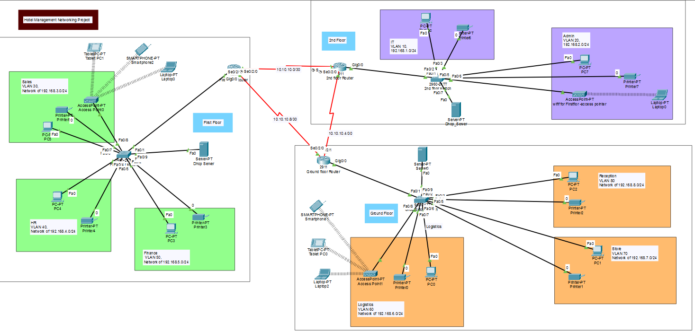
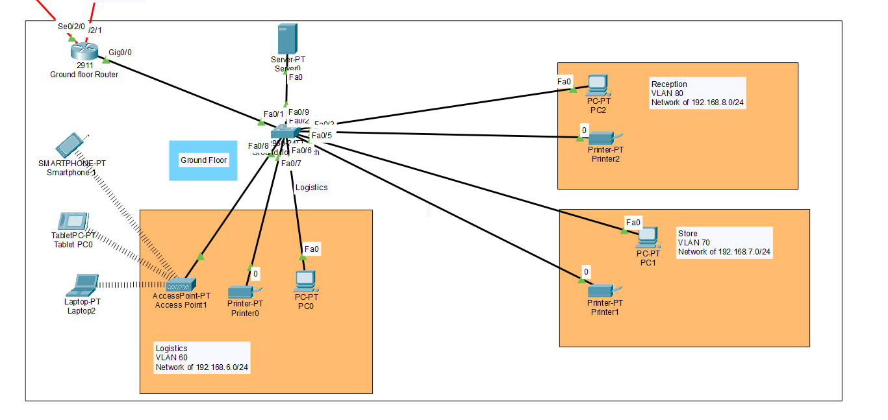
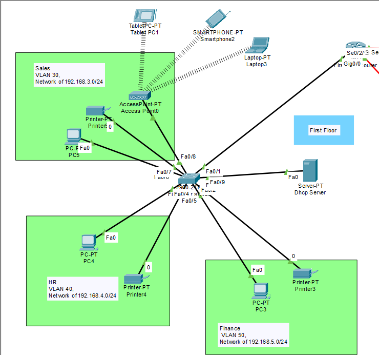
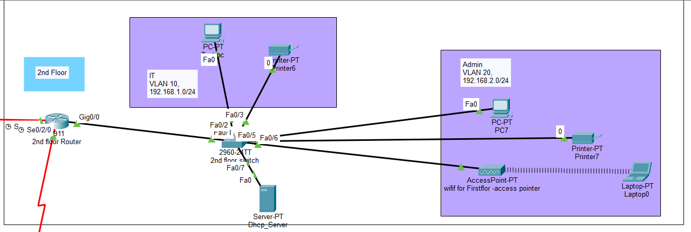

# Multi-Floor Enterprise Hotel Network Infrastructure

An enterprise-grade, multi-floor network architecture simulated in **Cisco Packet Tracer**, designed for departmental traffic isolation, inter-floor routing, centralized server services, and enterprise wireless integration[cite: 8].

---

## 📌 Network Topology Overview

### Full Network Architecture

---

### Floor Breakdowns

#### 1. Ground Floor (Logistics, Store & Reception)

#### 2. First Floor (Sales, HR & Finance)

#### 3. Second Floor (IT & Executive Administration)

---

## 🏢 Departmental Addressing & VLAN Allocation

| Floor | Department / Area | VLAN ID | Network Subnet | Default Gateway |
| :--- | :--- | :--- | :--- | :--- |
| **Ground Floor** | Logistics | VLAN 60 | `192.168.6.0/24` | `192.168.6.1` |
| **Ground Floor** | Store | VLAN 70 | `192.168.7.0/24` | `192.168.7.1` |
| **Ground Floor** | Reception | VLAN 80 | `192.168.8.0/24` | `192.168.8.1` |
| **1st Floor** | Sales & Wi-Fi | VLAN 30 | `192.168.3.0/24` | `192.168.3.1` |
| **1st Floor** | Human Resources (HR) | VLAN 40 | `192.168.4.0/24` | `192.168.4.1` |
| **1st Floor** | Finance | VLAN 50 | `192.168.5.0/24` | `192.168.5.1` |
| **2nd Floor** | IT Department | VLAN 10 | `192.168.1.0/24` | `192.168.1.1` |
| **2nd Floor** | Administration | VLAN 20 | `192.168.2.0/24` | `192.168.2.1` |

---

## 🌐 Point-to-Point WAN Backbone (Serial Links)

| Link Description | Interface 1 | Interface 2 | Subnet |
| :--- | :--- | :--- | :--- |
| **1st Floor Router ↔ 2nd Floor Router** | `Se0/2/0` | `Se0/2/0` | `10.10.10.0/30` |
| **2nd Floor Router ↔ Ground Floor Router** | `Se0/2/1` | `Se0/2/1` | `10.10.10.4/30` |
| **1st Floor Router ↔ Ground Floor Router** | `Se0/2/1` | `Se0/2/0` | `10.10.10.8/30` |

---

## 🛠️ Protocols & Technologies
* **Routing:** Dynamic Routing (RIPv2 / OSPF) & Inter-Floor Static Routes[cite: 6].
* **Switching:** 802.1Q Trunking, Inter-VLAN Routing (Router-on-a-Stick)[cite: 5].
* **Network Infrastructure:** Dedicated DHCP Servers, 802.11 Wireless Access Points[cite: 6, 8].
* **Hardware Platforms:** Cisco 2911 Routers, Cisco Catalyst 2960 Switches[cite: 8].

---

## 🚀 How to Run the Simulation
1. Open Cisco Packet Tracer (v8.0 or newer).
2. Open `configs/hotel management.pkt`[cite: 9].
3. Run diagnostics using `ping` or `traceroute` from any workstation to verify end-to-end communication[cite: 8].
